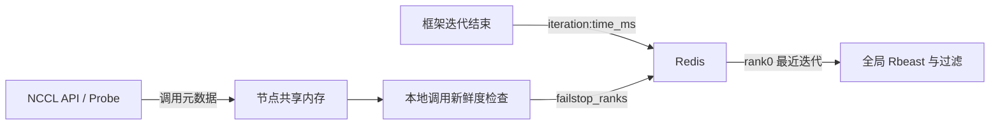

# FLASH M0 架构与接口草案

性质：PAPER 表示第三章事实；UPSTREAM 表示公开上游证据；ADAPTATION 表示本项目拟议工程措施；EXTENSION 表示基线外扩展。本文中的 ADAPTATION 仅为可审阅草案，尚未批准为实现协议。M0 不包含任何运行组件。

## 规格、范围与部署边界

PAPER：目标为第三章 FLASH：持续退化检测、按需剖析、group→rank 定位与 fail-stop 报告。主要依据 `references/chapter3.pdf`，摘录共 30 页；印刷页 p 的摘录页为 p−18，原 PDF 页为 p+16。`SPEC.md` 是提要，图表和公式以 PDF 为准。

ADAPTATION：开发仓库在 `gpu-01:/home/campus/zhangweihao/myflash`，由不存在的目录新建；目标部署为两台 H800，实际第二台主机、卡数、软件与互联仍待 M1a。H800 不自动等同于论文两机各 8 张 H200（§3.4.1 pp.36–37）。

本项目不做 SHIFT、恢复、迁移或 mitigation。不默认引入 GreyHound ACF 推断迭代、暂停训练的 validation/precheck、NCCL 控制广播或 stop-the-world 流程。Pre-check 在论文被提及，但实施细节缺失（G14）。DeepEP/Gloo/MPI、EP AllToAll 直接定位、硬件/软件/计算/网络根因分类不在本基线覆盖内（§3.1.3 p.23；§3.5 pp.46–47）。

## 三层职责与输入输出

| 组件 | 位置与输入 | 职责与输出 | 性质与来源 |
|---|---|---|---|
| NCCL Probe | 每个训练进程内，LD_PRELOAD 拦截 NCCL API；读取本地控制状态 | 调用元数据、communicator 标识写入共享内存；Profile 时在相应 stream 记录 CUDA Event duration | PAPER §3.2.1 pp.23–24；§3.3.1 pp.32–33 |
| 本地控制器 | 每节点一个 Python 进程；共享内存事件、Redis 状态与 rank0 迭代时间 | Monitor 统计调用新鲜度并上报停机候选；Profile 按 communicator 计算 min/max/avg/std 并上报 | PAPER §3.2.1 p.24；§3.2.4 p.31；§3.3.2 p.34 |
| 全局控制器 | 一个主节点 Python 进程；Redis 迭代序列、并行成员、comm 与统计 | Rbeast 检测与过滤、控制 0/1 状态、同标签两阶段定位、输出 rank/节点及标签证据 | PAPER §3.2.1 p.24；§3.3.2 pp.33–34 |
| 框架侧集成 | 训练迭代结束与并行初始化 | 上报迭代时间与 parallel states；不从 NCCL 记录推断迭代边界 | PAPER §3.2.2 pp.25–26；§3.3.3 p.35；G10 |

“透明 Probe + 框架少量集成”是本项目对接入范围的表述，不保证零改动或特定行数。论文的后台进程与回调描述尚待确定计时语义（G20）。

## Monitor：两条独立路径

PAPER：状态 0 不启用 CUDA Event，不从 CPU API 返回时间构造 GPU 时延。迭代列表 `iter_time_{rank}` 最多 500 条；rank0 是退化检测基准（§3.2.2 pp.25–26，图3-2）。

PAPER：滑动窗口 30、thresh_prob=0.8、degradation_thresh=0.2；前 3 迭代过滤；BOCD 前移除 z-score>3.0 异常点；相邻变点距离<2 时过滤后续点。论文称 BOCD 且使用 Rbeast，不能换成另一套 run-length 算法（G01）。

PAPER：`baseline_mean=mean(左侧)`，`degraded_mean=mean(右侧含变点)`，`recent_mean=mean(右侧不含变点)`；`recovery_ratio=(degraded_mean−recent_mean)/(degraded_mean−baseline_mean)`；≥0.75 过滤瞬时波动（§3.2.2 pp.26–27）。退化方向/分母、空切片、零方差/分母、过滤后索引映射、右侧保护区间与持续性时长仍未选定（G01/G02/G13）。

PAPER：本地按迭代时间调整无新 NCCL 调用窗口，例如 2 倍迭代时间；超时向 `failstop_ranks` 上报（§3.2.4 p.31）。该输出应称原始停机候选集合，不将连带阻塞或正常长计算自动解释为根故障；完整根因区别待验证（G08）。

## Profile：0→1→0 的控制边界

1. PAPER：全局检测命中后将 Redis 状态设为 1（§3.2.3 pp.27–28，图3-3）。
2. PAPER：各本地控制器每 100–500ms 轮询；写入共享内存原子控制字段。此范围是论文事实，具体周期未在 M0 选定。
3. PAPER：Probe 每次 GroupEnd 检查状态并切换行为。尚不擅自定义非 Group 或没有后续调用时的切换方案（G05）。
4. PAPER：采集窗口 `profile_period_s=max((latest_iter_time_ms/1000)×2.2,20.0)`。毫秒到秒转换显式列出；不能为贴近实验中“约 1 迭代”而改窗口（G03）。
5. PAPER：在 NCCL 相应 stream 上记录起止 Event；Group 首条调用开始、GroupEnd 后结束；`cudaEventSynchronize(stop_event)` 等待，再读 elapsed time。这个剖析路径会阻塞主机等待，不能声称完全异步。一个 Group 共用一对事件，将总 duration 写回各条记录（§3.2.3 p.29；§3.3.1 p.33）。
6. PAPER：本地按 communicator 聚合 min/max/avg/std，上报 Redis；全局结合 communicator 与 parallel states 执行定位（§3.3.2 pp.33–34）。
7. PAPER：分析完成将 Redis 状态恢复为 0，本地再次传播，Probe 在 GroupEnd 生效。M3 才验证无残留计时资源和状态。

ADAPTATION：拟议 `run_id`、`profile_epoch`、节点 ACK、采集起止/完整性与有限等待使控制与数据可追溯（G16）。还未定义超时或控制失联下的实现行为；不能伪造完整数据或健康结论。训练长时间无 GroupEnd、节点切换不同步、多 stream/comm、嵌套 Group、CUDA Graph、异步初始化均需先确认覆盖范围（G05/G06）。

## 两阶段 group→rank 定位

PAPER（§3.2.3 pp.30–31；§3.3.2 p.34）：

- 用 `id_hash` 建通信组，结合框架的实际 rank 成员标记 TP/DP/PP/expert_dp/expert_tp 等标签；无法判定标特殊组。不凭 EP/TP/PP 数字推断成员。
- 同标签先过滤单 rank 组；各组 `max_avg_latency=max(组内 communicator 平均时延)`。
- 仅一个可用组时直接 rank 分析；多个组时对各组 max_avg_latency 算 CV=std/mean，CV<0.1 跳过，否则选最大者。
- 候选组内按 rank 聚合其 communicator 时延，算 avg_latency。rank CV<0.1 跳过，否则最小 avg_latency 是候选。默认 20% 离群阈值参照量待定；样本/communicator 加权、NaN/零均值、重复 group 与冲突合并未选定（G04）。
- 同 rank 被多个标签支持时汇总标签和时延证据；得分不是校准的故障概率，不自行填补最小证据数或多故障消解机制（G04）。

PAPER：式3-1 `score_clique=(t_clique−mean_cliques)/mean_cliques` 用组平均量；式3-2 `score_rank=(mean_clique−t_rank)/mean_clique` 用 rank 平均量（§3.4.4 pp.41–42）。这是绘图统计口径，不能替代运行时 max_avg_latency 筛选。图3-4 与正文例子数值不一致（G17），不作为硬编码阈值或 fixture 标签。

ADAPTATION：缺失/坏数据不补零；不能进入最小 rank 选择。拟议输出包含 `candidate / skipped / insufficient_evidence`、标签、组成员、原始/聚合统计、跳过原因；格式在 M4 前审核（G16）。独立 evaluator 的真实注入 rank/时间/类别不向在线检测/定位器开放。

## 接口草案：字段与对象身份

下表是接口设计输入，不是已实现 ABI、schema 或冻结承诺。

| 记录 | PAPER 已给内容与出处 | ADAPTATION 拟议内容 / 未决项 |
|---|---|---|
| NCCL 事件 | communicator 地址、调用序号、时间戳、数据量 count、duration、Group 标识；§3.2.1 p.23、§3.3.1 pp.32–33 | run_id、node_id、PID、global_rank、comm_local_rank、op_type、dtype、stream 标识、monotonic_timestamp_ns、seq；布局/线程模型/return code 待 M2 审核 G07 |
| communicator 映射 | comm_ptr、id_hash、global_rank 简化记录；§3.3.1 p.32 | 用 `(run_id,node_id,pid,comm_ptr,生命周期)` 标本地对象；跨进程 id_hash 一致性/碰撞与 Init/Split 支持待 G06 |
| Group 记录 | Group 开始时递增计数，公共 duration 回填各条记录；§3.3.1 p.33 | Group ID 只在明确的进程/生命周期范围内有意义；拟增 `timing_scope=group_shared`，不能当独立 collective 耗时；G05 |
| parallel states | 初始化上报 TP/DP/PP/EP 实际成员；§3.3.3 p.35 | 框架组 ID、标签、全局 rank 列表与版本；多标签/同成员不同 comm 的匹配策略待 G04/G10 |
| 剖析统计 | 按 communicator 的 min/max/avg/std；论文仅上报 duration，§3.3.2 p.34、§3.5.2 p.46 | 显式 `duration_us`、`sample_count`、profile_epoch、完整性与丢失数；std 口径/聚合权重待定；count/dtype 原始审计不静默参与归一化 |
| 诊断 | 慢 rank、标签/通信组及延迟证据；§3.2.3 p.31 | run/epoch、节点映射、候选/跳过原因；真值只在独立 evaluator 侧 |

comm_ptr 是进程内地址，不能作跨进程键；id_hash 是跨进程组候选身份，不自动等同于框架进程组 ID；一次 Group 批量提交也不等同于通信组。相同成员的多个 NCCL comm 不合并成同一对象。

单位草案（ADAPTATION）：迭代 `time_ms`；控制窗口 `*_s`；事件 monotonic timestamp `*_ns`；统计 `duration_us`。Event 原始 elapsed time 的 ms 到 us 转换须保存；跨机 monotonic 值不能直接相减。NCCL `count` 为数据元素数，`byte_count=count×dtype_size` 是派生字节数，`sample_count` 是观测数，三者分离。

## 节点共享内存与 Redis 草案

PAPER（§3.3.1 pp.32–33）：环形缓冲区，元数据含字段数、容量、记录数、头尾、魔数、事件计数和状态；控制字段原子单写多读；写端加锁、Python 无锁读取且读完清空。论文未完整规定 ABI/发布协议，多线程、reader 重启、撕裂/溢出/清空竞态需 M2 验证（G07）。拟议 ABI 版本、序号、生命周期与丢失计数属 ADAPTATION，不能把尚未设计的并发协议写成论文事实。

| Redis 逻辑用途 | PAPER 字段 / 约定 | ADAPTATION 拟议隔离键（尚未冻结） |
|---|---|---|
| 框架迭代 | `iter_time_{rank}` 列表、`iteration:time_ms`，最多 500；p.25–26 | `flash:{run_id}:iter_time:{rank}` |
| 状态 | 值 0/1，原文未给精确键名；p.28 | `flash:{run_id}:state` |
| 停机候选 | `failstop_ranks` 列表；p.31 | `flash:{run_id}:failstop_ranks` |
| communicator / 并行成员 | Redis 中 comm 与 parallel states；p.32、p.35，精确 schema 缺失 | `flash:{run_id}:communicators`、`flash:{run_id}:parallel_states` |
| profiling 控制与统计 | 统计上报与恢复 0；p.28、p.34，轮次协议缺失 | `flash:{run_id}:profile:{epoch}:control/ack:{node}/stats:{node}` |

Redis 类型、写入原子性、TTL/清理策略、节点 ACK 与全局窗口归属均待 G16。不得 Redis FLUSHALL、全局清空 /dev/shm 或用旧 run 数据参与定位。Redis 位置/现有服务与访问范围在 M1a 盘点，M0 不启动服务。

EXTENSION：带宽、消息大小分桶、异步 Event 回收、复杂根因分类与其他通信库支持均不在默认基线；须另行批准、记录与对照。
